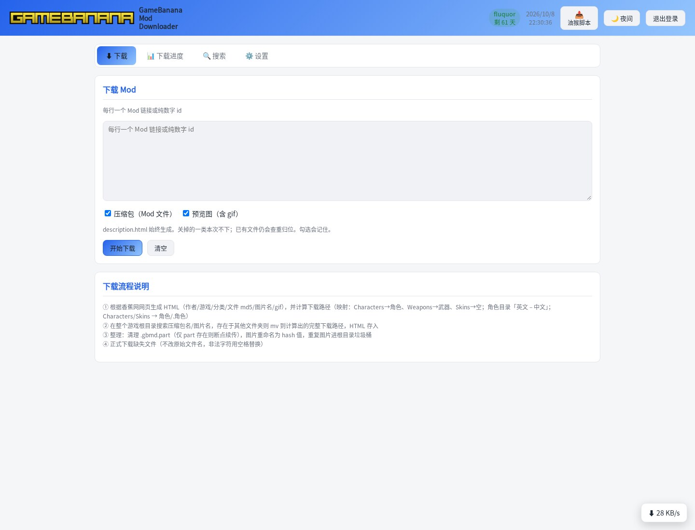
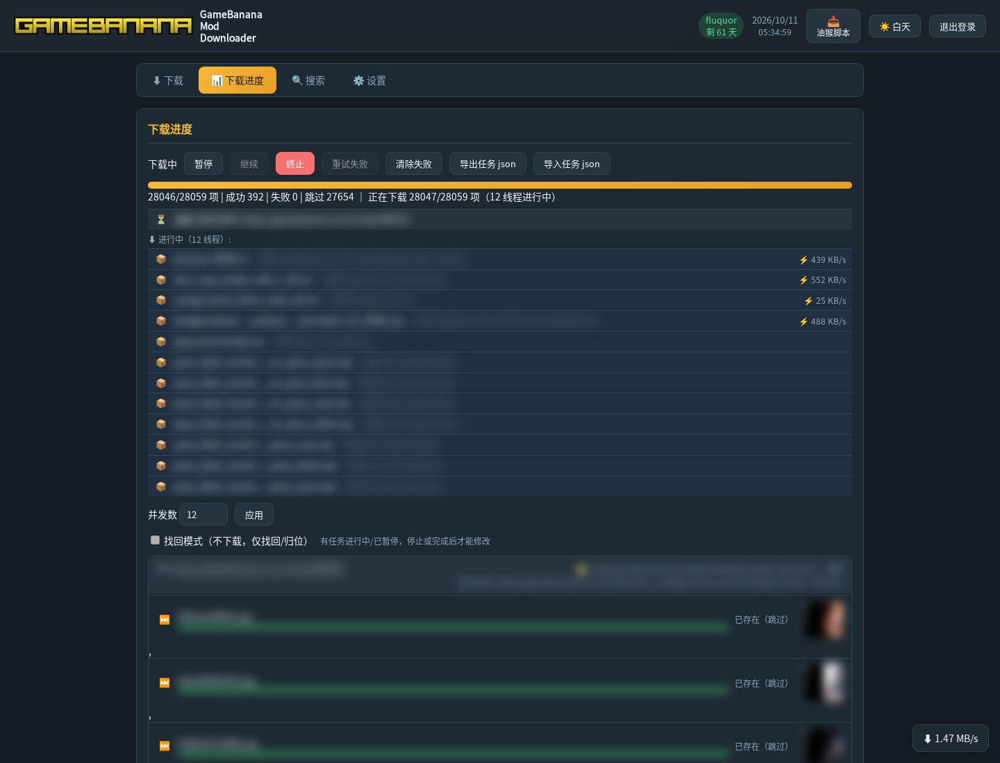
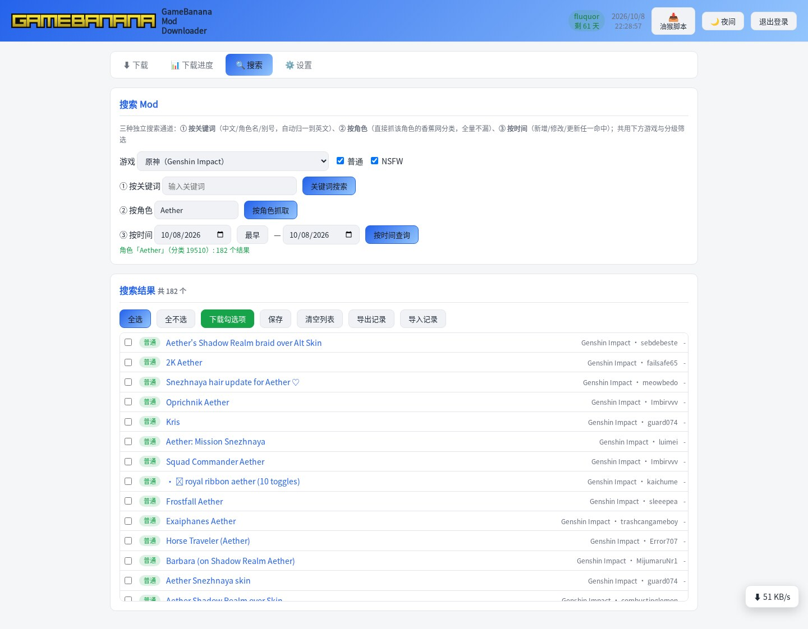

# GameBanana Mod Downloader

> 从 [GameBanana](https://gamebanana.com) 搜索、下载并自动整理 Mod 的零依赖 Node.js 服务：单进程、无 npm 依赖、自带网页界面，局域网浏览器直接用。

## 功能

| 功能 | 做什么 | 入口 |
| --- | --- | --- |
| 关键词搜索 | 中文/别名自动归一为英文规范名后搜索 | 网页「搜索」→ 关键词 |
| 按角色搜索 | 直接抓该角色的香蕉网分类，全量不漏 | 网页「搜索」→ 按角色 |
| 按时间搜索 | 新增 / 修改 / 更新任一命中 | 网页「搜索」→ 按时间 |
| 下载 | 生成 HTML → 查重归位 → 整理 → 并发下载 | `POST /api/download` |
| 断点续传 | Range 续传、失败重试、停滞检测、可跳过 | 下载任务内置 |
| 自动整理 | 按仓库/角色（英文 – 中文）/作者落盘 | 下载任务内置 |
| 回收站 | 重复项移入 `.trash`，可找回 | 下载任务内置 |
| 任务导入 | 导入一律追加，不清空现有队列 | `POST /api/task/import` |
| HTML 反查 | 文件 MD5 或图片原名反查所属 mod | 网页「设置 → HTML 反查」 |
| 文件夹合并 | 英文目录按映射重命名为「英文 – 中文」 | 网页「设置 → 文件夹合并」 |
| 网页设置 | 下载路径、Cookie、密码、映射、并发数 | 网页「设置」 |
| 下载进度 | 实时状态、进度条、预览图、单条重试 | 网页「下载进度」 |
| 主题切换 | 白天 / 夜间一键切换 | 网页右上角 |
| 油猴脚本 | GB 页面一键发送到服务器 | `/gamebanana-cookie-userscript.user.js` |
| 浏览器扩展 | Chrome MV3 扩展 + 原生消息宿主 | `crx/` |

## 环境要求

| 项 | 要求 |
| --- | --- |
| Node.js | 20+（零 npm 依赖，不建 `package.json`） |
| 平台 | Linux / macOS；Windows 用 `start-windows*.bat` |
| 网络 | 能访问 gamebanana.com；部分 mod 需登录 Cookie |

## 快速开始

### 方式一：启停脚本（Linux / macOS）

```bash
./start.sh --set-password "你的密码"   # 可选：设置访问密码（不启动服务）
./start.sh                             # 重启（默认；未运行则直接启动）
# 浏览器打开 http://<本机IP>:8642
```

### 方式二：Windows

```bat
start-windows.bat
```

未设置密码时只警告、可直接使用；局域网内任何人可访问，建议尽快设置。首次启动自动生成 `server/config.json`（默认端口 8642）。

### 启停命令

| 命令 | 作用 |
| --- | --- |
| `./start.sh` | 重启（默认；未运行则直接启动） |
| `./start.sh start [--port 8642]` | 启动 |
| `./start.sh stop` | 停止（只杀 PID 文件里的进程） |
| `./start.sh status` | 状态：进程 / HTTP 健康检查 / 日志 |
| `./start.sh --set-password "新密码"` | 设置访问密码（不启动服务） |

PID 文件为项目根 `<项目名>.pid`（不入库）；日志超过 10MB 在 start/restart 时轮转。

## 用法

### 网页界面

四个选项卡：**⬇ 下载 / 📊 下载进度 / 🔍 搜索 / ⚙ 设置**，右上角切换主题。

| 选项卡 | 能做什么 |
| --- | --- |
| 下载 | 批量输入 mod 链接或纯数字 id；勾选「压缩包 / 预览图」；一键开始 |
| 下载进度 | 实时状态与进度条、预览图放大、失败单条重试/跳过、并发数即时调节 |
| 搜索 | 三种通道（关键词 / 按角色 / 按时间），结果勾选后一键下载 |
| 设置 | 下载路径、Cookie 与登录检测、映射管理、文件夹合并、HTML 反查、改密 |

### 界面预览

| 登录（夜间） | 下载（夜间） |
| --- | --- |
|  |  |

| 下载进度（夜间，敏感信息已打码） | 搜索：三种通道（夜间） |
| --- | --- |
|  |  |

### 三种搜索通道

| 通道 | 用法 | 说明 |
| --- | --- | --- |
| 关键词 | `GET /api/keyword-search?q=<关键词>` | 中文/别名自动归一为英文规范名 |
| 按角色 | `GET /api/role-mods?game=<游戏>&role=<角色>` | 抓该角色分类的全量 mod |
| 按时间 | `POST /api/search`（body 带日期范围与排序） | 新增/修改/更新任一命中 |

### 任务导入

```bash
curl -s -X POST http://<本机IP>:8642/api/download \
  -H 'Content-Type: application/json' -d '{"mods":["704164"]}'   # 可传纯数字 id 或 mod 链接
```

导入一律追加，不清空现有队列；只有网页「终止」才清空队列。完整语义见 [数据格式与下载流程](docs/数据格式与下载流程.MD)。

### HTML 反查

```bash
curl -s 'http://<本机IP>:8642/api/hash-query?hash=69b46e18405cc'   # 输入可不带后缀、大小写不敏感
```

网页侧在「设置 → HTML 反查」：输入文件 MD5 或图片原名，本地命中显示实际目录，仅线上命中给「下载此 mod」按钮。

### 油猴脚本与浏览器扩展

```text
http://<本机IP>:8642/gamebanana-cookie-userscript.user.js   # 油猴脚本下载地址（.user.js 后缀是安装硬要求）
crx/extension                                               # 浏览器加载已解压的扩展这一目录
```

油猴脚本另可读取登录态并复制完整 Cookie（含 HttpOnly）到设置页；扩展需按 `crx/native-host/install-linux.sh` 注册原生消息宿主。

### 自动更新

```bash
curl -s http://<本机IP>:8642/api/auto-update/status                  # 查看状态与当前模式
curl -s -X POST http://<本机IP>:8642/api/auto-update/check           # 立即检查新版本（github 模式）
```

## API

| 端点 | 方法 | 说明 |
| --- | --- | --- |
| `/api/status` | GET | 服务状态与登录态 |
| `/api/login`、`/api/logout` | POST | 登录 / 登出 |
| `/api/change-password` | POST | 改密（已设密码需旧密码） |
| `/api/task` | GET | 任务摘要：状态/统计/活动项/待处理数 |
| `/api/task/items` | GET | 未完成项分页（`filter`/`offset`/`limit`） |
| `/api/task/done` | GET | 已完成项 |
| `/api/download` | POST | 提交 mod 链接或 id 下载 |
| `/api/task/import` | POST | 导入任务（追加） |
| `/api/receive` | POST | 油猴 / 扩展推送 |
| `/api/keyword-search` | GET | 关键词搜索 |
| `/api/role-mods` | GET | 按角色搜索（分类全量） |
| `/api/search` | POST | 按时间搜索 |
| `/api/hash-query` | GET | MD5 / 原名反查 |
| `/api/hash-rebuild` | POST | 重建反查索引 |
| `/api/io` | GET | IO 归因（按类型 / 按调用点） |
| `/api/auto-update/status` | GET | 自动更新状态 |

```bash
curl -s http://<本机IP>:8642/api/status
# {"ok":true,"needsSetup":true,"needsAuth":false}

curl -s http://<本机IP>:8642/api/task
# {"ok":true,"task":null}
```

## 测试

```bash
node --test                     # 自动发现 test/**/*.test.cjs
node test/gb-verify.cjs         # 联网实测：按角色链路的四项能力
```

## 文档索引

| 文档 | 内容 |
| --- | --- |
| [数据格式与下载流程](docs/数据格式与下载流程.MD) | 目录结构、游戏配置、映射、角色缓存、四步下载、任务语义、反查行为 |
| [常见问题](docs/常见问题.MD) | 使用与维护问答（Cookie/UA、队列、截图重新生成等） |
| [待办](docs/待办.MD) | 已完成结论与未完成项（拆分、存储瘦身、最后一项优化） |
| [索引存储技术文档](docs/索引存储技术文档.MD) | 索引后端选型、SQLite 实验与回退、内容 md5 不再回填的原因 |
| [下载任务存储瘦身](docs/20261011-下载任务存储瘦身.MD) | 任务文件体积治理与基准值对照表 |
| [CHANGELOG](docs/CHANGELOG.md) | 版本记录（按 git log 聚合） |

## 版本

当前版本：**1.3.10**；版本记录见 [docs/CHANGELOG.md](docs/CHANGELOG.md)。
